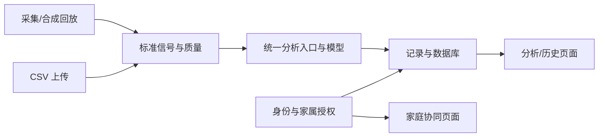

# 未卜心知：家庭心电辅助管理协作框架

基于 [tangyike1234/health_system-v2](https://github.com/tangyike1234/health_system-v2) 的派生改造，基线提交 `7e1a081a4be3e68d9b8cb2663f036d8107f3924d`。保留 React + TypeScript + FastAPI 及原主要目录，按团队讨论重新划分业务责任和分析链路。此分支不向上游仓库推送。

## 启动与验证

需要 Python 3.10+、Node.js 20.19+ 或 22.12+。从仓库根目录执行：

```powershell
python -m venv .venv
.venv\Scripts\python.exe -m pip install -r requirements-dev.txt
.venv\Scripts\python.exe run_backend.py
```

另一终端：

```powershell
cd frontend
npm ci
npm run dev
```

打开终端输出的 Vite 地址（通常 http://127.0.0.1:5173），注册账号、登录，使用“合成回放”或单列 CSV。API 文档：http://127.0.0.1:8000/docs 。没有默认账号。记录保存在仓库 `runtime/`，不提交到 Git。

验证命令（仓库根目录）：

```powershell
.venv\Scripts\python.exe -m pytest tests -q
cd frontend
npm run build
```

## 五人分工

| 成员 | 主责业务 | 对应代码 |
|---|---|---|
| 应用公共框架；账号与家庭协同的页面和接口 | frontend 的 App/Layout/Login/Family；api/auth.py、api/family.py、services/family.py |
| 心电记录与分析使用流程的页面和接口；业务框架与数据库 | frontend 的 Analyze/Records/Dashboard/Waveform；api/analyze.py、services/records.py、storage.py、main.py |
| 硬件、数据接收、设备控制及采集集成 | hardware/；api/acquisition.py 与两位软件负责人协作 |
| 数据获取、文件解析、质量、滤波、R 峰/特征与切分 | data/、signal_processing/ |
| 标签/患者级划分、模型训练评价；完整分析流水线与模型集成 | ai_model/pipeline.py、inference/、eval/、models/ |

两位软件人员各负责一条业务线的页面及接口。硬件集成归组员1，信号算法归组员2，模型和分析流水线集成归组员3；组员4调用统一分析入口，维护任务与持久化。详见 [具体任务与交接](docs/team_assignment.md)。

## 数据链路



## 已接通与待开发

- 已接通：账号注册/登录/退出及过期提示、受保护 API、CSV/合成输入、基础有效性检查、波形、SQLite 记录保存与详情、家庭邀请确认、列表/详情细分权限、撤回及站内通知状态。
- 质量仅检查长度、有限数值与平直，不表示已完成噪声检测。心率为 null；正式滤波、R 峰、真实模型及硬件均待实现。
- 未接模型返回 `model_unavailable`，质量不足返回 `skipped_quality`；分类与置信字段为空，不输出模拟“正常”。WebSocket 未就绪时拒绝连接，不返回固定心率。
- 当前分析同步执行；`task_status=completed` 表示流水线结束，不代表已产生 AI 分类。异步队列、分页/趋势、导出删除及外部健康警报属于下一阶段。
- 单导联心拍任务优先；原 ECGFounder 12 导联清单是扩展参考，不是当前已加载模型。

## 阅读顺序

1. [原链路问题与新结构](docs/architecture/overview.md)
2. [五人任务、交接与验收](docs/team_assignment.md)
3. [接口约定](interfaces/api_contract.md) 与 [数据结构](interfaces/data_schema.md)
4. [阶段计划](docs/timeline/milestones.md)

旧文档中与本方案不同的目录示意、日期和待办仅供追溯，不代表本分支已实现功能。此框架用于课程研究与辅助记录，不构成医疗诊断服务。
