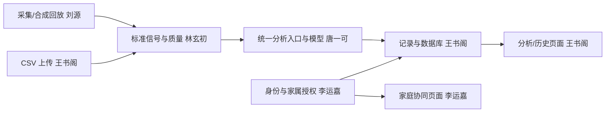

# 未卜心知：家庭心电辅助管理协作框架

基于 [tangyike1234/health_system-v2](https://github.com/tangyike1234/health_system-v2) 的派生改造，基线提交 `7e1a081a4be3e68d9b8cb2663f036d8107f3924d`。保留 React + TypeScript + FastAPI 及原主要目录，按团队讨论重新划分业务责任和分析链路。此分支不向上游仓库推送。

## 启动与验证

需要 Python 3.10+、Node.js 20.19+ 或 22.12+。从仓库根目录执行：

```powershell
python -m venv .venv
.venv\Scripts\python.exe -m pip install -r requirements-dev.txt
.venv\Scripts\python.exe run_backend.py
```

另一终端：

```powershell
cd frontend
npm ci
npm run dev
```

打开终端输出的 Vite 地址（通常 http://127.0.0.1:5173），注册账号、登录，使用“合成回放”或单列 CSV。API 文档：http://127.0.0.1:8000/docs 。没有默认账号。记录保存在仓库 `runtime/`，不提交到 Git。

验证命令（仓库根目录）：

```powershell
.venv\Scripts\python.exe -m pytest tests -q
cd frontend
npm run build
```

## AI 分析流程与硬件输入

唐一可负责的 AI 流程由统一入口 `ai_model/pipeline.py` 串联：

```text
ADS1292R 波形 CSV
→ 读取 ecg_filtered 列
→ 基础有效性检查
→ 本地信号质量评估
→ NeuroKit2 外部质量评估（已安装时）
→ 测量质量教练
→ OpenECG 分类
→ 三态结果决策
→ 可追溯 ECG 概念证据
→ DeepSeek 或本地模板解释
→ 保存并由前端展示
```

当前支持的 ADS1292R 波形文件应包含逐采样数据，例如：

```csv
timestamp(s),resp_raw,ecg_raw,resp_filtered,ecg_filtered
0.000,8806366,8925108,291826.1,-1937.7
0.002,8806351,8924897,290978.1,-1780.5
```

上传时采样率填写实际值，当前 OpenECG 适配器要求单导联 `500 Hz`、至少 `10 秒`，并使用前 `10 秒` 分析。解析器优先读取 `ecg_filtered`，不会把 `ECGHeatData` 中的心率、呼吸率、RR、QRS、QT 等设备计算指标当作模型输入。硬件 `ecg_filtered` 按 ADC 计数换算为 mV，使用 `VREF=2.42 V`、`PGA=6`：`mV = count × 2420 / (6 × 2^23)`；该列视为已经零中心滤波，不再减偏移码 `8388608`。原始 `ecg_raw` 不参与当前模型输入。若固件寄存器配置与此不同，需同步更新换算参数。普通单列 CSV 不做 ADC 换算。

质量评估输出运动干扰、基线漂移、疑似工频干扰、信噪比代理值和平直信号等工程指标，并生成坐稳、贴紧电极、远离电器等复测动作。质量不足时跳过分类；分类结果还会经过 `signal_invalid`、`model_uncertain`、`assistive_classification` 三态决策，不能展示为确定性医疗诊断。

解释输出包括通俗说明、专业解读、分析依据、限制、不确定性、安抚说明、测量指导、下一步建议和紧急症状提醒。解释结果中还会标记 `provider`、`api_called` 和 `fallback_reason`，用于确认是否实际调用远程大模型。

## AI 依赖、模型与配置

`requirements-dev.txt` 已包含测试、OpenECG 和 NeuroKit2，安装全部开发依赖即可：

```powershell
.venv\Scripts\python.exe -m pip install -r requirements-dev.txt
```

也可以只安装真实 ECG 模型相关依赖：

```powershell
.venv\Scripts\python.exe -m pip install -r requirements-ai.txt
```

真实 OpenECG 分类需要在项目根目录 `.env` 中设置：

```dotenv
ECG_MODEL_TYPE=openecg
```

NeuroKit2 暂时默认禁用，质量评估只使用项目本地规则；需要重新启用外部质量评估时设置：

```dotenv
ECG_QUALITY_PROVIDER=neurokit2
```

需要使用 DeepSeek 解释时配置：

```dotenv
ECG_EXPLANATION_PROVIDER=deepseek
ECG_LLM_MODEL=deepseek-chat
DEEPSEEK_API_KEY=你的密钥
```

解释 API 调用失败会自动回退到本地模板。`.env` 和真实 API Key 不得提交到 Git。

## 可选 OpenECG 安装与公开测试数据

`requirements-ai.txt` 固定已完成本机联调的 `openecg[report]==0.11.0` 和 `neurokit2==0.2.13`，模型依赖和权重不上传 Git。

Windows PowerShell（仓库根目录）：

    .venv/Scripts/python.exe -m pip install -r requirements-ai.txt
    Copy-Item .env.example .env

仅在首次配置时复制模板，已有 .env 不要覆盖。将其中 ECG_MODEL_TYPE 改为 openecg，再启动或重启后端。系统环境变量优先于项目根目录 .env，未配置时默认 none。模板不含真实密钥。

    .venv/Scripts/python.exe run_backend.py

模型首次运行可能需要获取模型资源，请确保网络可用。当前适配器只接受 500 Hz、至少 10 秒的单导联 mV 信号，并仅分析前 10 秒。不能通过改填采样率或重复数据来凑时长。

已提供 csv/ptbxl_00001_lead_II_500Hz_10s.csv：PTB-XL 公开记录的 II 导联，5000 点、500 Hz、10 秒。导入时采样率填 500，来源、转换说明及 CC BY 4.0 许可见 [样本说明](csv/README.md)。旧记录不会自动重新分析；安装或调整模型后需要重启后端并创建新记录。

没有显式设置 `ECG_EXPLANATION_PROVIDER=deepseek` 或 `openai_compatible` 时使用本地模板。OpenECG 分类成功与外部大模型解释是两项独立功能。

## 目录与提交边界

| 目录/文件 | 用途 |
|---|---|
| tests/ | pytest 配置及全部自动测试；CI 执行 python -m pytest tests -q |
| csv/ | 公开联调 CSV、来源 JSON 和许可；不存放测试 Python 脚本 |
| runtime/ | 本机数据库、任务、上传和运行产物，不提交 |
| requirements-dev.txt | 后端、自动测试、OpenECG 与 NeuroKit2 依赖 |
| requirements-ai.txt | OpenECG 与 NeuroKit2 的 AI 依赖 |
| .env.example | 可提交的配置模板；实际 .env、密钥不提交 |

.venv、.venv-tasks、node_modules、构建产物、模型权重和缓存均不提交。csv/ 只允许已注明来源的公开样本进入版本管理；其他本地数据保留在电脑上。自动测试强制使用 none 分类器和本地解释模板，不依赖个人 .env、下载的模型或外部 API。

## 五人分工

| 成员 | 主责业务 | 对应代码 |
|---|---|---|
| 李运嘉 | 应用公共框架；账号与家庭协同的页面和接口 | frontend 的 App/Layout/Login/Family；api/auth.py、api/family.py、services/family.py |
| 王书阁 | 心电记录与分析使用流程的页面和接口；业务框架与数据库 | frontend 的 Analyze/Records/Dashboard/Waveform；api/analyze.py、services/records.py、storage.py、main.py |
| 刘源 | 硬件、数据接收、设备控制及采集集成 | hardware/；api/acquisition.py 与两位软件负责人协作 |
| 林玄初 | 数据获取、文件解析、质量、滤波、R 峰/特征与切分 | data/、signal_processing/ |
| 唐一可 | 标签/患者级划分、模型训练评价；完整分析流水线与模型集成 | ai_model/pipeline.py、inference/、eval/、models/ |

两位软件人员各负责一条业务线的页面及接口。硬件集成归刘源，信号算法归林玄初，模型和分析流水线集成归唐一可；王书阁调用统一分析入口，维护任务与持久化。详见 [具体任务与交接](docs/team_assignment.md)。

## 数据链路



## 已接通与待开发

- 已接通：账号注册/登录/退出、受保护 API、CSV/合成输入、基础有效性检查、波形、SQLite 记录保存与详情、家属直接授权及撤回、站内授权提示。
- 已接通本地工程质量筛查和可选 NeuroKit2 外部质量证据；质量结果不代表临床可用性。默认分类器为 none，不生成心率；配置 OpenECG 后可产生分类、心率和心拍指标，但不等于已完成自研信号算法或模型性能评价。
- 未接模型返回 `model_unavailable`，质量不足返回 `skipped_quality`；分类与置信字段为空，不输出模拟“正常”。WebSocket 未就绪时拒绝连接，不返回固定心率。
- 当前上传/回放返回 HTTP 202 和任务编号，由后台执行，状态通过 `/api/v1/tasks/{id}` 查询；`task_status=completed` 表示流水线结束，不代表已产生 AI 分类。任务状态和输入已持久化；重启后未完成任务标为 failed 并提示重新提交。历史分页、记录趋势汇总、本人 CSV/JSON 导出和删除已实现；邀请确认及外部健康警报仍待开发。
- 单导联心拍任务优先；原 ECGFounder 12 导联清单是扩展参考，不是当前已加载模型。

## 可选代码与审查边界

代码包含 `ECG_MODEL_TYPE=openecg` 可选分类器及模板/外部解释模块，默认分类器仍为 none；可选依赖、权重、真实推理与效果尚未验收，不改变以上默认功能状态。外部解释默认不调用，需显式配置；文字解释不能代替模型评价。

2026-10-21 文档审查：前端生产构建通过；现有 .venv 无法启动，系统 Python 缺少 pytest，未完成本轮后端全套测试。多列硬件 CSV 测试与单列解析实现冲突，详见 [验证与审查](docs/VALIDATION.md)。

## 阅读顺序

1. [原链路问题与新结构](docs/architecture/overview.md)
2. [五人任务、交接与验收](docs/team_assignment.md)
3. [接口约定](interfaces/api_contract.md) 与 [数据结构](interfaces/data_schema.md)
4. [阶段计划](docs/timeline/milestones.md)

各模块文档已按本 README 统一；候选协议、模型清单和 C 头文件均为扩展参考，不代表已实现功能。此框架用于课程研究与辅助记录，不构成医疗诊断服务。

## 本地任务阶段启动

本轮已建立独立依赖环境 `.venv-tasks`（原 `.venv` 保留）：

```powershell
.venv-tasks\Scripts\python.exe run_backend.py
```

前端仍在 frontend 执行 npm run dev。上传后 URL 包含 task 编号，刷新可继续查询；完成后自动进入记录详情。当前为单进程后台任务，勿启用多 worker。重启未完成任务会失败并提示重新提交，尚无自动重试队列。
