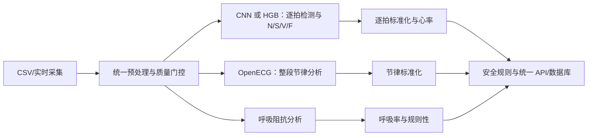
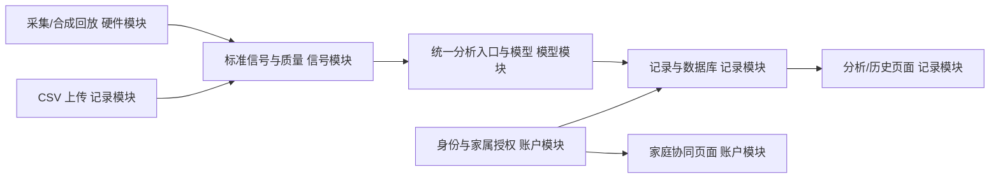

# 未卜心知：家庭心电辅助管理协作框架

## 2026-11-25 · v0.2.1 记录详情页更新

本次更新发布在 `ai` 分支，版本标签为 `v0.2.1`。记录详情页优先展示估算心率、检测心拍与信号质量；支持原始/滤波波形切换、逐拍结果展开和明确的未分类心拍统计，技术参数与质量细节按需展开。详见 [更新日志](CHANGELOG.md) 和 [本次更新、验证与回退说明](docs/releases/v0.2.1.md)。

拉取后需重新构建前端，已运行的旧 EXE 不会自动更新。本次没有数据库迁移或模型权重变更。

## 2026-11-12 电脑推理与实时采集更新

已迁入 [ecg-edge-analysis](https://github.com/lykzr/ecg-edge-analysis) 的 CNN H27、HGB v92 权重及检测/特征链路，直接在电脑 CPU 推理；新增 ADS1292R 蓝牙串口采集、最近5秒实时波形、逐拍结果、采集保存及历史换模型重分析。账号、家庭授权、任务与原有历史数据保持原流程。

本机共享环境为 `E:\Environments\Python\pytorch`。从本项目根目录运行 `./start_pc.ps1`，打开 http://127.0.0.1:8000 。首次拉取或源码修改后，在 frontend 运行 `npm.cmd ci` 和 `npm.cmd run build` 生成网页。完整启动、协议选择、依赖、模型来源、验证和局限见 [电脑推理与蓝牙采集指南](docs/PC_MIGRATION.md)。

已使用旧版的组员请在原来的项目目录拉取并重启，继续使用原 `runtime/health.sqlite3` 或原先配置的 `HEALTH_DB_PATH`。后端启动时会自动追加亲属关怀表，已有账号、密码和共享授权可以继续使用。首次在本机运行的组员请先在登录页注册账号。

CSV 页面和实时页面按任务明确选择 CNN/HGB，实时模型约每4秒重算当前会话的完整前缀，停止后完整分析。支持在记录详情导出带红色网格和校准脉冲的单导联心电 PNG。新采集模块接入后，按指南选择实际串口及数据帧格式，并完成采集验收。旧 EXE 保留，不会自动包含此次更新。

以下是原框架说明；其中“实时未实现”“默认无模型”等描述指旧版状态。未指定模型的 API 仍遵循 ECG_MODEL_TYPE 配置，页面已显式传入选择的模型。

基于既有心电项目整合，保留 React + TypeScript + FastAPI 及原主要目录，按模块职责组织业务与分析链路。

## 2026-11-15 多模型融合架构

统一分析入口现按职责拆分模型：CNN/HGB 只负责逐拍 QRS 定位与 N/S/V/F 分类，OpenECG 只负责整段节律分析；两类结果分别写入 `beat_analysis` 与 `rhythm_analysis`，不再互相覆盖。CNN/HGB 不可用时仅在明确选择逐拍模型的情况下调用 NeuroKit2/SciPy 做 R 峰回退；选择 `none` 时保持旧框架行为，不生成推测心率。呼吸通道由独立 `RespirationAnalyzer` 处理，最终再由固定安全规则合并提示。



## 启动与验证

需要 Python 3.10+、Node.js 20.19+ 或 22.12+。从仓库根目录执行：

```powershell
python -m venv .venv
.venv\Scripts\python.exe -m pip install -r requirements-dev.txt
.venv\Scripts\python.exe run_backend.py
```

另一终端：

```powershell
cd frontend
npm ci
npm run dev
```

打开终端输出的 Vite 地址（通常 http://127.0.0.1:5173），注册账号、登录，使用“合成回放”或单列 CSV。API 文档：http://127.0.0.1:8000/docs 。没有默认账号。记录保存在仓库 `runtime/`，不提交到 Git。Windows PowerShell 若提示 `npm.ps1` 禁止运行脚本，改用 `npm.cmd run dev`。

完整步骤、启动代码与常见报错见[启动指南](docs/GETTING_STARTED.md)。

验证命令（仓库根目录）：

```powershell
.venv\Scripts\python.exe -m pytest tests -q
cd frontend
npm run build
```

## 可选 OpenECG 安装与公开测试数据

基础依赖只运行网站框架和测试；需要真实 OpenECG 分类时，另外使用项目虚拟环境安装 requirements-ai.txt。该文件固定已完成本机联调的 openecg[report]==0.11.0，模型依赖和权重不上传 Git。

Windows PowerShell（仓库根目录）：

    .venv/Scripts/python.exe -m pip install -r requirements-ai.txt
    Copy-Item .env.example .env

仅在首次配置时复制模板，已有 .env 不要覆盖。将其中 ECG_MODEL_TYPE 改为 openecg，再启动或重启后端。系统环境变量优先于项目根目录 .env，未配置时默认 none。模板不含真实密钥。

    .venv/Scripts/python.exe run_backend.py

模型首次运行可能需要获取模型资源，请确保网络可用。当前适配器固定使用 OpenECG 0.11.0 自带的 `codec_v6_int8.onnx`，并记录权重大小及 SHA-256。输入必须是 500 Hz、至少 10 秒的单导联 mV 信号；长记录按 10 秒窗口分析，默认步长 5 秒（`ECG_RHYTHM_STEP_SECONDS=5`），最后不足一个步长的尾段也会覆盖。不能通过改填采样率或重复数据来凑时长。依赖装在哪个虚拟环境，就用哪个环境的 python 启动；只在 .env 写 openecg 不会安装模型包，启动后记录一直显示“未接入模型”时先用该环境的 python -c "import openecg" 自检。

已提供 csv/ptbxl_00001_lead_II_500Hz_10s.csv：PTB-XL 公开记录的 II 导联，5000 点、500 Hz、10 秒。导入时采样率填 500，来源、转换说明及 CC BY 4.0 许可见 [样本说明](csv/README.md)。旧记录不会自动重新分析；可在详情页点“重新分析”或新建记录。

外部解释模块目前读取进程环境变量，单独在 .env 填写 DeepSeek 变量不会启用远程解释。没有显式启用时使用本地模板；API Key 不提交 Git。OpenECG 分类成功与外部大模型解释是两项独立功能。

## 目录与提交边界

| 目录/文件 | 用途 |
|---|---|
| tests/ | pytest 配置及全部自动测试；CI 执行 python -m pytest tests -q |
| csv/ | 公开联调 CSV、来源 JSON 和许可；不存放测试 Python 脚本 |
| runtime/ | 本机数据库、任务、上传和运行产物，不提交 |
| requirements-dev.txt | 基础后端与自动测试依赖 |
| requirements-ai.txt | 可选真实 ECG 模型依赖 |
| .env.example | 可提交的配置模板；实际 .env、密钥不提交 |

.venv、.venv-tasks、node_modules、构建产物及缓存均不提交；迁入的冻结 CNN/HGB 研究权重随来源、校验清单和许可提交，其他本地权重不提交。csv/ 只允许已注明来源的公开样本进入版本管理；其他本地数据保留在电脑上。自动测试使用独立配置和本地解释模板，不依赖个人 .env 或外部 API；新增模型集成测试使用仓库中的 CNN/HGB 权重，真实 CNN 测试需要安装 CPU PyTorch。

## 五人分工

| 成员 | 主责业务 | 对应代码 |
|---|---|---|
| 账户模块 | 应用公共框架；账号与家庭协同的页面和接口 | frontend 的 App/Layout/Login/Family；api/auth.py、api/family.py、services/family.py |
| 记录模块 | 心电记录与分析使用流程的页面和接口；业务框架与数据库 | frontend 的 Analyze/Records/Dashboard/Waveform；api/analyze.py、services/records.py、storage.py、main.py |
| 硬件模块 | 硬件、数据接收、设备控制及采集集成 | hardware/；api/acquisition.py 与两位软件负责人协作 |
| 信号模块 | 数据获取、文件解析、质量、滤波、R 峰/特征与切分 | data/、signal_processing/ |
| 模型模块 | 标签/患者级划分、模型训练评价；完整分析流水线与模型集成 | ai_model/pipeline.py、inference/、eval/、models/ |

两位软件人员各负责一条业务线的页面及接口。硬件集成归硬件模块，信号算法归信号模块，模型和分析流水线集成归模型模块；记录模块调用统一分析入口，维护任务与持久化。详见 [具体任务与交接](docs/team_assignment.md)。

## 数据链路



## 已接通与待开发

- 已接通：账号注册/登录/退出、受保护 API、CSV/合成输入、基础有效性检查、波形、SQLite 记录保存与详情、家属邀请接受/拒绝、撤回与退出共享、站内通知；任务列表与取消、重启恢复、记录摘要/筛选/趋势时区、数据库迁移与健康自检；波形外置存储、窗口波形接口、原始文件下载、重分析与备注；任务事件时间线、访问审计查询与保留清理、数据库备份脚本。
- 基础质量仅检查长度、有限数值与平直，不表示已完成噪声检测。默认框架模式不生成心率；可选 OpenECG 路径能产生分类与心率，但不等于已完成自研信号算法或模型性能评价。
- 未接模型返回 `model_unavailable`，质量不足返回 `skipped_quality`；分类与置信字段为空，不输出模拟“正常”。WebSocket 未就绪时拒绝连接，不返回固定心率。
- 当前上传/回放返回 HTTP 202 和任务编号，由进程内单 worker 队列执行，状态通过 `/api/v1/tasks/{id}` 查询；`task_status=completed` 表示流水线结束，不代表已产生 AI 分类。任务状态和输入已持久化；重启后 pending 任务重新入队，running 任务标为 `interrupted`（单进程前提）。历史分页、记录筛选、趋势汇总（含时区）、本人 CSV/JSON 导出和删除、原件下载、重分析与备注已实现；家庭邀请须由接收方确认后生效，7 天未处理自动过期。
- 单导联心拍任务优先；原 ECGFounder 12 导联清单是扩展参考，不是当前已加载模型。

## 可选代码与审查边界

代码包含 `ECG_MODEL_TYPE=openecg` 可选分类器及模板/外部解释模块，默认分类器仍为 none；可选依赖、权重、真实推理与效果尚未验收，不改变以上默认功能状态。外部解释默认不调用，需显式配置；文字解释不能代替模型评价。

2026-10-21 文档审查：前端生产构建通过；现有 .venv 无法启动，系统 Python 缺少 pytest，未完成本轮后端全套测试。多列硬件 CSV 测试与单列解析实现冲突，详见 [验证与审查](docs/VALIDATION.md)。

## 阅读顺序

1. [原链路问题与新结构](docs/architecture/overview.md)
2. [五人任务、交接与验收](docs/team_assignment.md)
3. [接口约定](interfaces/api_contract.md) 与 [数据结构](interfaces/data_schema.md)
4. [阶段计划](docs/timeline/milestones.md)

各模块文档已按本 README 统一；候选协议、模型清单和 C 头文件均为扩展参考，不代表已实现功能。此框架用于课程研究与辅助记录，不构成医疗诊断服务。

## 本地任务阶段启动

本轮已建立独立依赖环境 `.venv-tasks`（原 `.venv` 保留）：

```powershell
.venv-tasks\Scripts\python.exe run_backend.py
```

前端仍在 frontend 执行 npm run dev。上传后 URL 包含 task 编号，刷新可继续查询；完成后自动进入记录详情。当前为单进程后台任务，勿启用多 worker；重启后 pending 任务自动重新入队，running 任务标为 interrupted（单进程前提），尚无自动重试队列。

备份与恢复见[运维与备份](docs/operations.md)：`python business_logic/scripts/backup_db.py` 会生成带完整性校验的 `runtime/backups/health-*.sqlite3`。
