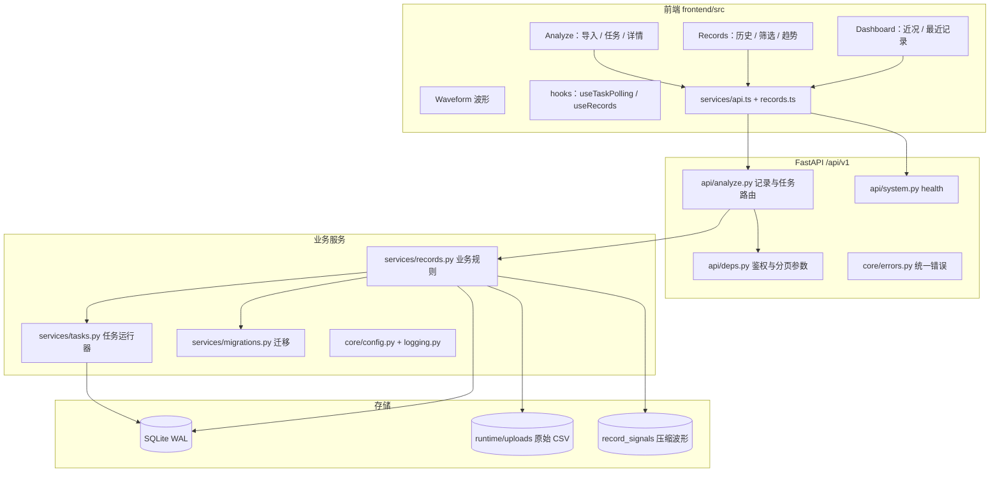
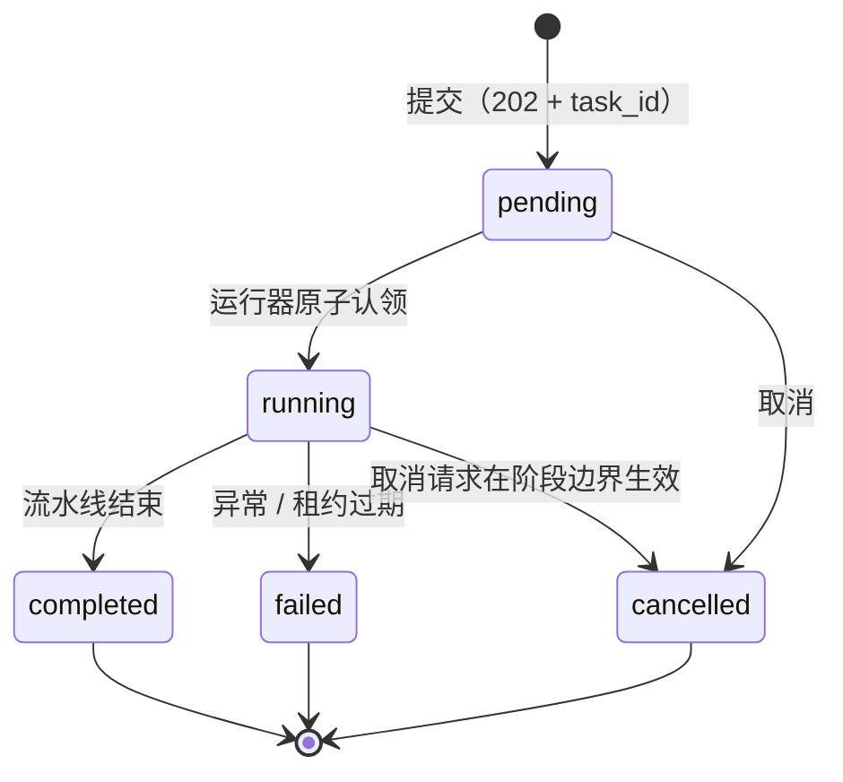
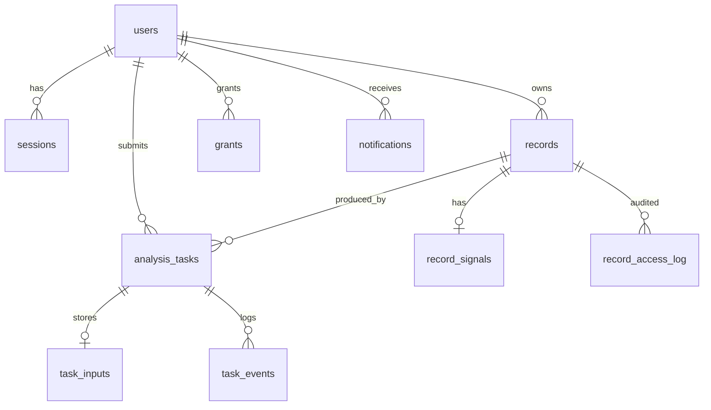

# 记录与分析使用流程完善方案

**作者**：记录模块　**分支**：`分析界面分支`　**日期**：2026-10-28

**范围**：`frontend` 的 Analyze / Records / Dashboard / Waveform；`business_logic` 的 `api/analyze.py`、`services/records.py`、`storage.py`、`main.py`；以及由我维护的数据库与业务框架。

**依据**：[根 README](../../README.md) 五人分工（第 70 行）与[分工交接](../team_assignment.md)、[接口契约](../../interfaces/api_contract.md)、[数据结构](../../interfaces/data_schema.md)、[验证记录](../VALIDATION.md)、[里程碑](../timeline/milestones.md)。

**不在本方案内的内容**：CSV 解析、质量算法、滤波、R 峰、模型训练与推理（信号模块、模型模块）；设备协议与采集适配（硬件模块）；账号、家属邀请确认与通知（账户模块）。本方案只定义与他们的交接字段和失败语义，不代写算法。

## 摘要（先看这段）

- **现状判断**：上传→任务→保存→回看的主链路已经接通，但记录只有时间与 ID 可查；任务不可列出、不可取消；失败原因是一段异常字符串；结果整块存 `payload`，列表与趋势要逐条解析；没有索引与迁移机制。
- **方案主线**：给 `records` 加摘要列 + 索引 + 迁移框架（查得快、改得动）；任务列表/取消/重分析/租约恢复（看得见、可追溯）；波形与原件外置 + 窗口接口（扛得住 20 万点）；页面拆分 + 轮询 hook + 筛选/趋势图/详情元数据（用得顺）。
- **节奏**：P0 先解决“看得见、查得到、失败知道为什么”（约 6 人日），P1 解决波形/原件/重分析（约 4 人日），P2 打磨审计与运维（约 2 人日）。每阶段都能独立验收、独立演示。
- **底线**：不伪造模型结果；共享只读；接口只增不改；迁移前备份；不代写信号与模型算法。

---

## 1. 目标与判断标准

### 1.1 三条用户旅程

1. **第一次使用**：注册 → 导入 CSV 或合成回放 → 看到任务进度 → 看到可解释的结果 → 能回看、导出。
2. **日常回看**：打开历史 → 按时间/质量筛选 → 看趋势 → 点进详情 → 删除或重新分析。
3. **家庭协同**：家属收到授权 → 只读查看记录与趋势 → 不能导出/删除/重分析。

### 1.2 本阶段的完成标准

| 维度 | 标准 |
|---|---|
| 可追溯 | 每条记录能回答：谁、何时、用什么输入、哪个处理版本、哪个任务、结果是什么、是否被重分析过 |
| 可恢复 | 刷新、关页面、服务重启后，任务状态不丢；pending 任务能继续执行；中断的任务有明确原因 |
| 可查询 | 列表与趋势不依赖逐条解析结果 JSON；1000 条记录下列表 < 150 ms、趋势 < 300 ms |
| 可验证 | 每个新增接口有 pytest 用例；页面关键状态有前端测试或手工验收脚本；CI 仍为 `pytest tests -q` + `npm run build` |
| 边界清晰 | 无模型时不伪造结果；共享只读；家属导出权限未确认前默认拒绝 |

### 1.3 本轮验证基线说明

本地用 `.venv-tasks` 执行 `python -m pytest tests -q`，部分用例通过后因 Windows 沙箱拒绝 pytest 临时目录访问而中断（`tmp_path` fixture 报 `PermissionError`），未取得完整基线；[验证记录](../VALIDATION.md) 中 2026-10-24 的 14 项通过仍是最近一次完整结果。实施第一步应在可写临时目录环境重跑并记录，避免把环境问题误判为代码回归。

---

## 2. 现状核对

### 2.1 已经接通的部分（以代码为准）

- 上传 `POST /analyze/ecg`（单列 CSV、2 MB、HTTP 202）与合成回放 `POST /acquisition/replay`；两者都写入 `analysis_tasks` + `task_inputs`，由 `BackgroundTasks` 后台执行。
- `GET /tasks/{id}`：仅任务本人可见；`completed` 且有 `record_id` 时附带完整记录。
- 记录持久化：`records(id, owner_id, created_at, payload)`；`GET /records` 支持分页与 `shared=true`；`GET /records/{id}` 支持本人或有效授权查看。
- 历史能力：`GET /records/trends`（UTC 按日）、`GET /records/{id}/export`（CSV/JSON）、`DELETE /records/{id}`（本人，事务清理记录/任务/输入）。
- 页面：导入/回放、轮询跳转、详情分区展示、历史分页/趋势/导出/删除、概览近 30 天统计。
- 测试：`tests/test_api_flow.py` 覆盖两用户隔离、授权撤回、任务失败、待执行任务、分页/趋势/导出/删除。

### 2.2 问题清单

按“页面 / 接口 / 数据 / 框架”分组，编号供任务拆解引用。

#### 页面

| 编号 | 现象 | 影响 |
|---|---|---|
| G1 | `Analyze.tsx` 单文件同时承担上传、轮询、详情、解释展示，37 行内大量单行密集代码 | 改一处易碰坏另一处；无法复用详情 |
| G2 | 进度只依赖 URL 的 `?task=`，没有任务列表；关闭标签页或清除参数后无法找回进行中的任务 | 用户以为任务丢了；只能重传 |
| G3 | 固定 1 秒轮询，无退避、无页面隐藏暂停、无 `AbortController` | 后台标签页持续请求；卸载后仍可能 setState |
| G4 | 上传无客户端大小/列数预检、无进度、无幂等 | 大文件要等整段上传才报 413；重复点击产生两条记录 |
| G5 | 详情页没有记录元数据表（任务、来源、导联、单位、采样率、版本），也没有重新分析、导出、删除入口 | 导出/删除只能回列表；无法解释“这条记录怎么来的” |
| G6 | 共享记录不显示所有者；导出/删除按钮只是被禁用，没有说明原因 | 家属不知道自己看的是谁的记录、为什么不能操作 |
| G7 | 历史页无筛选（时间、质量、来源）；筛选状态不进 URL；趋势只有文字行，没有图形 | 记录变多后无法定位；刷新丢筛选 |
| G8 | `Waveform` 用固定步长抽点（`step = ceil(n/3000)`），可能跳过 R 峰；无坐标刻度、无峰值标记 | 波形失真，看起来“平”或漏搏 |
| G9 | `duration_sec?.toFixed(1)`、`explanation_detail` 等运行时可能缺失 | 字段缺失时页面白屏 |
| G10 | 前端零测试；CI 只跑 `tsc --noEmit` + build | 逻辑回归只能靠手工发现 |

#### 接口

| 编号 | 现象 | 影响 |
|---|---|---|
| G11 | `GET /records` 列表项只有 `id/created_at` | 列表无法显示质量、心率、来源；只能逐条请求详情 |
| G12 | 没有任务列表、取消、重分析入口 | 进行中任务不可发现；模型升级后旧记录无法重跑 |
| G13 | 错误体只有 `detail` 字符串：`ValueError→400、PermissionError→401、LookupError→404、IntegrityError→409`，任务失败只存 `TypeError: ...` 文本 | 前端无法区分“可重试/需换文件/无权限”；日志无法关联 |
| G14 | 同一类输入错误语义不一致：多列 CSV 同步 400，非法采样率却进入任务后 failed | 用户与测试都要按两套逻辑处理 |
| G15 | 没有请求 ID、没有结构化日志；`middleware/logging.py`、`tracing.py` 未挂载 | 页面报错无法定位后端请求 |
| G16 | 健康检查硬编码 `model: unavailable`，不报告数据库可写、迁移版本、队列深度 | 部署与联调无法自检 |
| G17 | 导出 CSV 无 BOM；无原始文件下载；导出/删除无审计 | Excel 中文乱码；无法核对“导出的是否等于上传的” |

#### 数据

| 编号 | 现象 | 影响 |
|---|---|---|
| G18 | 结果整块存在 `records.payload`，无摘要列；`trend()` 为了算日均心率要 `json.loads` 每条记录 | 复杂度 O(全库字节)；记录变多后趋势与列表明显变慢 |
| G19 | 没有任何二级索引（除主键） | 分页 `COUNT(*)`、按 owner 查询随数据量线性退化 |
| G20 | 无迁移机制：`initialize()` 只有 `CREATE TABLE IF NOT EXISTS`，`db/init.sql` 只有注释 | 加列对已有 `runtime/health.sqlite3` 不生效；没有版本可追溯 |
| G21 | 波形与结果同存 `payload`：10 s @ 500 Hz ≈ 50 KB，20 万点 ≈ 2 MB | 详情/导出每次整块读；无法按时间窗取数；备份膨胀 |
| G22 | 删除是手工按顺序 `DELETE`，未来新增波形表/原件文件后容易漏删；无访问审计 | 数据残留或误删；家属导出争议无证据 |
| G23 | SQLite 未设置 WAL 与 `busy_timeout` | 后台写 + 请求读并发时可能 `database is locked` |

#### 任务与框架

| 编号 | 现象 | 影响 |
|---|---|---|
| G24 | `BackgroundTasks` 无并发上限、无优雅停机；`recover_tasks()` 启动时把所有 pending/running 一律置 failed | 多任务争抢 CPU/SQLite；重启后排队任务被迫重提 |
| G25 | 任务表缺 `started_at/finished_at/stage/error_code/worker_id/heartbeat_at/attempt/cancel_requested/idempotency_key` | 只能显示“排队/处理中”；失败原因不可分类；不能取消 |
| G26 | 单进程限制只写在 README，没有启动守卫 | 误配多 worker 会互相把任务标失败 |
| G27 | 配置分散在 `os.environ` 与未使用的 `app/config.py`（依赖未安装的 `pydantic_settings`，无法导入） | 上传上限、目录、租约等无统一来源 |

---

## 3. 总体方案

### 3.1 分层与调用关系



规则：**API 层只做参数解析与错误转换；业务规则（权限、状态、可重试性）在 `services`；SQL 集中在少数函数里；跨模块调用只走 `ai_model.pipeline.analyze` 与 `signal_processing.parse_csv`。**

### 3.2 记录生命周期



`completed` 只表示流水线结束，**不表示有模型输出**；是否有分类结果看 `outcome`：

| `outcome` | 含义 | 页面文案 |
|---|---|---|
| `classified` | 模型返回标签 | “分析完成” |
| `skipped_quality` | 质量不足，跳过分类 | “信号质量不足，未做分类” |
| `model_unavailable` | 未配置模型 | “分析完成，当前未接入模型” |
| `failed` | 执行失败 | 按 `error_code` 给建议 |

### 3.3 关键取舍（ADR）

| 编号 | 决定 | 理由 | 代价 |
|---|---|---|---|
| ADR-1 | 任务用**进程内队列 + 数据库租约**，不引入 Redis/Celery | 单机课程部署，零外部依赖；租约让重启恢复可判定 | 仍不支持多实例；用启动守卫拦截误配（G26） |
| ADR-2 | `records` 增加**摘要列**，`payload` 继续保存结果 JSON | 列表/趋势/筛选走 SQL；详情仍一次取全量 | 结果与摘要需在同一事务写入，必须回填 |
| ADR-3 | 波形与原始文件**外置**：`record_signals`（zlib + float32）+ `runtime/uploads` | 20 万点不再塞进每条记录；支持按窗口取数、原件下载 | 需要一次数据迁移；导出与详情要走兼容读取 |
| ADR-4 | 删除保持**硬删除**，不引入软删除 | 与现有测试和“删除后不可恢复”的提示一致；避免隐私残留 | 审计只能记录动作元数据，不能保留内容 |
| ADR-5 | 时间统一存 UTC；统计与展示接受 `timezone` 参数 | 解决 UTC 日切导致的“昨天/今天”错位 | Windows 需要 `tzdata` 依赖（当前环境缺失，见 6.7） |
| ADR-6 | 响应**只增不改**：保留 `detail` 字符串、`/records` 不传 `page` 返回数组、`/analyze/{id}` 别名 | 不破坏账户模块页面与既有测试 | 旧字段会长期存在，需要弃用说明 |

---

## 4. 接口方案

### 4.1 通用约定

- 前缀 `/api/v1`；除 `health`、`auth/register`、`auth/login` 外均需 `Authorization: Bearer <token>`。
- 时间：存储与返回 UTC ISO 8601（`2026-10-28T06:25:05+00:00`）；查询参数 `from`/`to` 接受 `YYYY-MM-DD` 或 ISO 时间，`to` 含当日。
- 错误体（新增 `code`、`request_id`，保留 `detail` 字符串）：

```json
{"detail": "记录不存在或没有查看权限", "code": "record_not_found", "request_id": "b1c0e6f2", "field": null}
```

| 状态码 | 语义 |
|---|---|
| 400 | 输入无效（时区、导出格式、备注过长） |
| 401 | 未登录或会话失效（前端统一退出） |
| 404 | 不存在或无权（不泄露资源是否存在） |
| 409 | 状态冲突（取消已完成任务、重分析缺输入、用户已存在） |
| 413 | 上传超过 2 MB |
| 422 | 框架参数校验失败（分页越界等） |
| 503 | 任务运行器不可用（仅在关闭/异常时） |

- 分页：`page ≥ 1`、`page_size ∈ [1,100]`（默认 20）；响应 `items/page/page_size/total/pages`。
- 幂等：`POST /analyze/ecg` 支持 `Idempotency-Key`（≤64 字符）；同用户同 key 返回原任务（HTTP 200，首次 202）。当前不做过期清理。
- 权限：记录读取 = 本人或有效授权（`grants.active=1`）；导出、删除、重分析、备注、原件 = **仅本人**（家属导出待确认，见第 11 节）。
- 路由顺序：`/records/trends` 必须声明在 `/records/{identifier}` 之前（现状已如此），新增固定路径同理。

### 4.2 接口清单

| 方法 | 路径 | 状态 | 说明 |
|---|---|---|---|
| GET | `/health` | 增强 | 数据库、迁移版本、队列、模型配置、能力上限 |
| POST | `/analyze/ecg` | 调整 | 202 返回 Task；支持 `Idempotency-Key`；错误带 `error_code` |
| GET | `/tasks/{id}` | 增强 | 增加 `stage/outcome/error_code/started_at/finished_at/duration_ms/cancel_requested` |
| GET | `/tasks` | **新增** | 本人任务分页列表，可按状态过滤 |
| POST | `/tasks/{id}/cancel` | **新增** | pending 立即取消；running 协作取消 |
| POST | `/records/{id}/reanalyze` | **新增** | 用已存输入重跑，返回新 Task（202） |
| GET | `/records` | 增强 | 摘要字段、`from/to/quality/label/q/sort`、共享记录带 `owner_username` |
| GET | `/records/trends` | 增强 | `timezone`、零填充、`summary`、心率 min/max |
| GET | `/records/{id}` | 增强 | 顶层摘要字段 + `metadata` + `supersedes_record_id` + `note` |
| PATCH | `/records/{id}` | **新增** | 本人备注（≤500 字符），为空可清除 |
| GET | `/records/{id}/waveform` | **新增** | 时间窗 + 包络降采样（≤8000 点） |
| GET | `/records/{id}/raw` | **新增** | 本人下载原始上传 CSV |
| GET | `/records/{id}/export` | 增强 | 增加 `format=raw`；CSV 加 BOM 与备注列 |
| DELETE | `/records/{id}` | 增强 | 级联波形/原件/事件，写访问审计 |
| GET | `/analyze/{id}` | 保留 | 记录详情的兼容别名，文档标注弃用候选 |

### 4.3 新增接口详述

#### 4.3.1 `GET /tasks`

```
GET /api/v1/tasks?status=pending,running&page=1&page_size=20
```

```json
{
  "items": [{
    "id": "9f2c...", "status": "running", "stage": "inference", "outcome": null,
    "source": "csv_import", "error": null, "error_code": null, "record_id": null,
    "created_at": "2026-10-28T06:20:00+00:00", "updated_at": "2026-10-28T06:20:04+00:00",
    "started_at": "2026-10-28T06:20:01+00:00", "finished_at": null,
    "duration_ms": null, "cancel_requested": false
  }],
  "page": 1, "page_size": 20, "total": 1, "pages": 1
}
```

- 仅本人；按 `updated_at DESC, id DESC`。
- 用于刷新恢复、概览“进行中”提示、取消入口。
- `stage` 取值：`queued | validating | preprocessing | inference | explaining | finished`。

#### 4.3.2 `POST /tasks/{id}/cancel`

| 当前状态 | 返回 | 行为 |
|---|---|---|
| pending | 200，`status=cancelled` | 直接终止，不再执行 |
| running | 200，`status=running, cancel_requested=true` | 阶段边界生效；模型调用中不强制中断 |
| completed/failed/cancelled | 409 `task_finished` | 不改状态 |

#### 4.3.3 `POST /records/{id}/reanalyze`

- 权限：仅本人（共享只读 → 404）。
- 输入优先取 `task_inputs.payload`；若有原始文件则重新解析（保证与当前解析器一致）。
- 返回 202 Task，`source_record_id` 指向原记录；新记录写 `supersedes_record_id`。
- 原记录保留；列表默认不合并，详情显示“该记录由 … 重分析得到 / 已有更新版本 …”。
- 原始输入已清理 → 409 `input_unavailable`。
- 用途：解决 README 所述“安装或调整模型后需要创建新记录”的痛点，且不覆盖历史结果。

#### 4.3.4 `GET /records` 查询参数

| 参数 | 类型 | 说明 |
|---|---|---|
| `shared` | bool | `true` 查授权给本人的记录 |
| `page` / `page_size` | int | 不传 `page` 保持旧数组响应 |
| `from` / `to` | date/ISO | `created_at` 闭区间 |
| `quality` | enum | `basic_checks_passed` / `insufficient` / `unknown` |
| `label` | string | 按存储值精确匹配；不做白名单（标签契约归模型模块） |
| `q` | string | 记录 ID 前缀（≥4 字符）或备注包含；LIKE 通配符转义 |
| `sort` | enum | `created_at_desc`（默认）/ `created_at_asc` |

列表项（本人）：

```json
{
  "id": "a1b2", "created_at": "2026-10-28T06:20:05+00:00", "task_id": "9f2c",
  "source": "csv_import", "duration_sec": 10.0, "sample_rate_hz": 500.0,
  "quality_status": "basic_checks_passed", "quality_score": null,
  "label": null, "confidence": null, "heart_rate_bpm": null,
  "note": null, "updated_at": "2026-10-28T06:20:05+00:00"
}
```

共享视图额外 `owner_username`（如团队决定匿名则改为 `owner_label`，见第 11 节）。

#### 4.3.5 `GET /records/trends` 增强

```
GET /api/v1/records/trends?days=30&shared=false&timezone=Asia/Shanghai&fill=1
```

```json
{
  "days_requested": 30,
  "timezone": "Asia/Shanghai",
  "shared": false,
  "summary": {
    "total": 12, "classified": 0, "insufficient": 2,
    "heart_rate_days": 3, "avg_heart_rate_bpm": null,
    "last_record_at": "2026-10-28T06:20:05+00:00"
  },
  "days": [{
    "date": "2026-10-28", "records": 2,
    "quality": {"basic_checks_passed": 1, "insufficient": 1},
    "classified": 0, "heart_rate_bpm": 72.5,
    "heart_rate_min_bpm": 60.0, "heart_rate_max_bpm": 85.0
  }]
}
```

- `timezone` 非法 → 400 `invalid_timezone`；默认 `UTC` 保持前端旧行为兼容，前端显式传本地时区。
- `fill=1`（默认）返回连续 `days` 天，空日期 `records=0`；`fill=0` 只返回有记录的日期。
- 口径说明：只统计已保存结果；不是疾病风险预测（沿用 README 表述）。

#### 4.3.6 `GET /records/{id}/waveform`

```
GET /api/v1/records/{id}/waveform?start_sec=0&end_sec=10&max_points=2000&mode=envelope
```

```json
{
  "record_id": "a1b2", "sample_rate_hz": 500.0, "unit": "mV",
  "total_samples": 5000, "start_sec": 0.0, "end_sec": 10.0,
  "returned_points": 4000, "mode": "envelope",
  "points": [{"t": 0.0, "v": -0.012}, {"t": 0.002, "v": 0.031}],
  "peaks_sec": [0.42, 1.22, 2.01]
}
```

- `mode=envelope`：每桶保留极小值、极大值两点（按时间排序），保证 R 峰不被抽掉；`mode=mean`：每桶均值。
- `max_points ∈ [100,8000]`，默认 2000；`start_sec < end_sec`，超出范围自动裁剪。
- 共享只读可访问；`peaks_sec` 仅在结果里存在峰值时返回（字段由信号模块/模型模块提供，见 4.5）。

#### 4.3.7 `GET /records/{id}/raw`

- 仅本人；返回原始上传字节流，`text/csv; charset=utf-8`。
- 文件名固定 `ecg-record-{id}-raw.csv`，**不反射用户上传的文件名**（避免响应头注入与路径问题）。
- 无原件（合成回放、迁移前旧记录）→ 409 `raw_unavailable`。

#### 4.3.8 `PATCH /records/{id}`

```json
{"note": "早上起床后测量，服药前"}
```

- 仅本人；`note` ≤500 字符，空串清除；其他字段一律 400 `unsupported_field`。
- 返回更新后的详情；`note` 出现在详情、列表、JSON 导出和 CSV 末列。

#### 4.3.9 `GET /health` 增强

```json
{
  "status": "ok", "version": "2026.10",
  "database": {"writable": true, "schema_version": 5},
  "tasks": {"mode": "inprocess", "workers": 1, "pending": 0, "running": 1},
  "model": {"type": "none", "configured": false, "loaded": null},
  "acquisition": "replay_only",
  "capabilities": {
    "upload_formats": ["csv"], "max_upload_bytes": 2097152,
    "max_samples": 200000, "waveform_max_points": 8000, "timezone": true
  }
}
```

- 不触发模型加载：`loaded` 只读取流水线最近一次状态（需模型模块提供 `classifier_status()`），无状态时为 `null`，不谎报。
- 不暴露绝对路径（安全）。
- 数据库不可写时返回 503，便于部署检查。

### 4.4 兼容与弃用

| 项 | 策略 |
|---|---|
| `GET /records` 不传 `page` | 继续返回数组，数组项追加摘要字段 |
| `GET /analyze/{id}` | 保留为详情别名；文档标注弃用，至少保留两个阶段 |
| `record.result` 结构 | 不改；新增顶层摘要字段与 `metadata` |
| 错误体 | 保留 `detail` 字符串；新增 `code/request_id` |
| 任务 `status` 枚举 | 只新增 `cancelled`；前端对未知状态按“处理中”兜底 |
| 导出 CSV 列 | 只追加 `note`，表头前缀不变 |

### 4.5 与其余四人的交接字段

| 交接方 | 需要提供 | 用于 | 未提供时的降级 |
|---|---|---|---|
| 信号模块 | `parse_csv` 的元数据：`lead`、`unit`、`sample_rate_hz`、`captured_at`、`sequence`、缺失标记；质量 `score/grade`；`peaks_sec` | 详情元数据、波形峰值、质量徽章 | 字段为空，页面显示“—”；峰值不渲染 |
| 模型模块 | `analyze()` 输出：`prediction.status/label/confidence/model_version`、`outcome`、`analysis_window_sec`、`classifier_status()` | 结果分区、任务 outcome、health | `label=null` 显示“未接入模型”；`loaded=null` |
| 硬件模块 | 设备记录：`device_id`、`captured_at`、序号/丢帧标记、单位与校准 | 详情元数据、未来设备记录来源 | 回放记录显示 `synthetic_replay` |
| 账户模块 | 授权语义（只读）、是否允许家属导出、共享记录是否显示用户名、通知事件 | 权限判断、共享视图、导出策略 | 默认只读、默认拒绝导出、显示用户名 |
| 全员 | 失败语义：哪些异常属于输入错误、哪些属于模型不可用 | `error_code` 映射 | 统一归 `analysis_failed`，附原始消息到日志 |

---

## 5. 页面方案

### 5.1 信息架构

```
/                 概览：进行中任务 + 近 30 天摘要 + 最近 5 条记录
/analyze          导入：上传 / 回放 / 当前任务进度 / ?task= 恢复
/records          历史：筛选 + 趋势图 + 列表 + 分页（筛选状态进 URL）
/records/:id      详情：元数据 + 波形 + 结果 + 解释 + 操作
```

路由仍由 `App.tsx`（账户模块）持有，我只保证页面组件可独立挂载；不修改 `/family`。

### 5.2 导入与分析页

**结构拆分**（替换现有 37 行单文件）：

```
pages/Analyze.tsx            组合与路由参数
features/analyze/UploadForm.tsx      文件、采样率、校验、提交
features/analyze/TaskProgress.tsx    阶段时间线、取消、刷新恢复
features/analyze/RecordDetail.tsx    详情容器
features/analyze/ResultSections.tsx  质量/分类/心率/心拍/解释
features/analyze/MetadataGrid.tsx    记录元数据表
```

**上传表单**

- 拖放区 + 点击选择；显示“单列 CSV，UTF-8，≤2 MB，≤200000 点；采样率 50–2000 Hz”。
- 客户端预检：扩展名 `.csv`、大小 ≤2 MB、读取前 8 KB 判断列数（>1 列且无 `ecg_filtered` → 提示“首版仅单列”，不擅自截取）。
- 采样率默认 250；若文件名匹配 `_500Hz_` / `_250Hz_` 只做**建议**并高亮，需用户确认，不静默改。
- 提交按钮进入 loading，禁用重复点击；每次提交生成 `Idempotency-Key = crypto.randomUUID()`，成功后重置。
- 上传进度用 `XMLHttpRequest.upload.onprogress`（`fetch` 无上传进度），封装为 `uploadWithProgress`。
- 合成回放作为次要按钮，说明“10 秒 250 Hz 合成信号，用于演示”。

**任务进度**

- 阶段时间线：排队 → 校验 → 预处理 → 推理 → 解释 → 完成；未知阶段归入“处理中”。
- 显示任务 ID（等宽字体，可复制）、已用时间、取消按钮。
- 轮询：800 ms 起，每次 ×1.5，上限 5 s；`document.hidden` 时暂停，`visibilitychange` 恢复立即查询；卸载 `AbortController.abort()`。
- 完成：`navigate('/records/'+record_id, {replace:true})` 并显示一次性成功提示；失败：按 `error_code` 给建议（换文件 / 稍后重试 / 任务已取消）。
- 页面顶部提供“进行中的任务”小列表（来自 `/tasks?status=pending,running`），支持刷新后继续跟踪。

**详情页**

1. 头部：记录时间（本地时区）、质量徽章、来源徽章、共享者（如有）。
2. 操作区：导出 CSV / JSON / 原始文件、重新分析、删除（二次确认，显示时间与 ID）、返回列表。共享视图只显示“返回”。
3. 元数据表：记录 ID、任务 ID、来源、导联、单位、采样率、时长、点数、处理版本、模型版本、结果状态、重分析链。
4. 波形卡片（见 5.6）。
5. 结果分区：质量（状态、评分、原因、范围说明）→ 分类（标签、置信度、模型版本）→ 心率（bpm、min/max、规律性）→ 心拍（数量、室早）→ 解释（通俗说明、专业解读、依据、不确定性、下一步、引擎）。
6. 版本与免责声明页脚。
7. 空态：`label=null` 显示“当前未接入模型，仅完成信号检查”，**不显示“正常”**；字段缺失显示“—”。
8. 视觉层级：质量不足时黄色提示并把分类区折叠；错误时红色提示 + 折叠的技术详情（task_id、request_id、原始错误）。

### 5.3 历史页

- 筛选栏：时间范围（7/30/90/自定义）、质量、来源、关键词、共享开关；全部写入 URL query，刷新/前进后退可恢复。
- 摘要卡：近 N 天记录数、质量不足数、有平均心率的天数、最近一次记录时间。
- 趋势图：SVG 组合图（柱=每日记录数，线=日均心率），悬停显示当日明细，下方保留文字表格供读屏；无数据时给“去导入第一条记录”的 CTA。
- 列表行：时间、来源、时长、质量徽章、心率、分类、操作。共享行显示所有者与“只读”标签，操作区只保留“查看”。
- 分页：上一页/下一页 + 页码 + 每页 10/20/50；删除当前页最后一条时自动回退一页。
- 删除：`<dialog>` 二次确认（可键盘操作），成功后 toast + 刷新当前页。
- 错误：区分 401（跳登录）、404（记录已被删除）、其他（重试按钮）。

### 5.4 概览页

- 进行中任务横幅（有则显示，链接到 Analyze）。
- 近 30 天摘要（记录数、质量不足、心率天数、最近记录）。
- 最近 5 条记录（复用列表行组件）。
- 保留五人分工介绍卡片，但下移。
- 单一数据请求 `/records/trends?days=30` + `/records?page_size=5`；不重复请求两份趋势（现状 Dashboard 与 Records 各拉一次，可接受，但概览只拉一次）。

### 5.5 波形组件

- 纯函数 `decimate(values, maxBuckets)`：按桶输出 min/max 两点，保留尖峰；单元测试固定输入断言不过峰。
- 渲染：≤10k 点用 SVG `<polyline>`；>10k 点用 `<canvas>`（`devicePixelRatio` 适配），配 `figcaption` 摘要与隐藏数据表。
- 坐标：横轴 0–时长（1 s/5 s 自适应刻度），纵轴 mV（min/max 标注）；网格沿用现有视觉。
- 峰值：若 `peaks_sec` 存在，画竖线标记；点击标记显示 RR 间期（若提供）。
- 交互（P2）：悬停十字线 + 时间/幅值提示；缩放与拖动依赖 `/waveform` 窗口接口。
- 卸载时取消 `requestAnimationFrame`，避免后台重绘。

### 5.6 前端工程

- 类型集中在 `types/records.ts`：`RecordSummary`、`RecordDetail`、`TaskSummary`、`TrendPoint`、`TrendsResponse`、`Page<T>`；页面不再直接依赖后端原始 JSON 形状。
- `services/api.ts` 只保留 `request/downloadFile/uploadWithProgress` 与错误类型 `ApiError{status,code,requestId}`。
- `hooks/useTaskPolling`、`useRecords`、`useTrends` 各自管理 `loading/error/data/refresh`，页面只组合。
- 组件：`QualityBadge`、`StatusBadge`、`EmptyState`、`ErrorNotice`、`ConfirmDialog`、`TrendChart`、`Waveform`。
- 可访问性：表单 `<label>` 关联、状态区 `role="status"`、确认框焦点陷阱、图表 `aria-label`、颜色对比 ≥4.5:1。
- 响应式：≤640 px 时筛选栏纵向排列，列表行折行，趋势图高度 180 px。
- 测试：`vitest + jsdom + @testing-library/react`，覆盖 `decimate`、`useTaskPolling`（假定时器与可见性）、`Records` 筛选参数构造、错误映射。CI 增加 `npm run test`。

---

## 6. 数据库方案

### 6.1 目标结构



归属：`users/sessions/grants/notifications` 的字段变更由账户模块确认；我只新增索引与只读查询，不改变其语义。

### 6.2 `records` 摘要列（迁移 0002）

```sql
ALTER TABLE records ADD COLUMN task_id TEXT;
ALTER TABLE records ADD COLUMN source TEXT;
ALTER TABLE records ADD COLUMN lead TEXT;
ALTER TABLE records ADD COLUMN unit TEXT;
ALTER TABLE records ADD COLUMN sample_rate_hz REAL;
ALTER TABLE records ADD COLUMN duration_sec REAL;
ALTER TABLE records ADD COLUMN n_samples INTEGER;
ALTER TABLE records ADD COLUMN quality_status TEXT;
ALTER TABLE records ADD COLUMN quality_score REAL;
ALTER TABLE records ADD COLUMN label TEXT;
ALTER TABLE records ADD COLUMN confidence REAL;
ALTER TABLE records ADD COLUMN heart_rate_bpm REAL;
ALTER TABLE records ADD COLUMN model_version TEXT;
ALTER TABLE records ADD COLUMN processing_version TEXT;
ALTER TABLE records ADD COLUMN note TEXT;
ALTER TABLE records ADD COLUMN input_path TEXT;
ALTER TABLE records ADD COLUMN input_sha256 TEXT;
ALTER TABLE records ADD COLUMN supersedes_record_id TEXT REFERENCES records(id);
ALTER TABLE records ADD COLUMN updated_at TEXT;
```

回填（SQLite 3.45 已确认支持 JSON1）：

```sql
UPDATE records SET
  task_id            = json_extract(payload, '$.task_id'),
  source             = json_extract(payload, '$.result.source'),
  lead               = json_extract(payload, '$.result.lead'),
  unit               = json_extract(payload, '$.result.unit'),
  sample_rate_hz     = json_extract(payload, '$.result.sample_rate_hz'),
  duration_sec       = json_extract(payload, '$.result.duration_sec'),
  n_samples          = json_array_length(payload, '$.result.waveform'),
  quality_status     = json_extract(payload, '$.result.quality.status'),
  quality_score      = json_extract(payload, '$.result.quality.score'),
  label              = json_extract(payload, '$.result.prediction.label'),
  confidence         = json_extract(payload, '$.result.prediction.confidence'),
  heart_rate_bpm     = COALESCE(
                         json_extract(payload, '$.result.prediction.heart_rate.bpm'),
                         json_extract(payload, '$.result.heart_rate_bpm')),
  model_version      = json_extract(payload, '$.result.prediction.model_version'),
  processing_version = json_extract(payload, '$.result.processing_version'),
  updated_at         = created_at
WHERE payload IS NOT NULL;
```

### 6.3 索引

```sql
CREATE INDEX IF NOT EXISTS idx_records_owner_created   ON records(owner_id, created_at DESC);
CREATE INDEX IF NOT EXISTS idx_records_owner_quality   ON records(owner_id, quality_status, created_at DESC);
CREATE INDEX IF NOT EXISTS idx_records_task            ON records(task_id);
CREATE INDEX IF NOT EXISTS idx_tasks_owner_updated     ON analysis_tasks(owner_id, updated_at DESC);
CREATE INDEX IF NOT EXISTS idx_tasks_status_created    ON analysis_tasks(status, created_at);
CREATE INDEX IF NOT EXISTS idx_grants_relative_active  ON grants(relative_id, active, owner_id);
CREATE INDEX IF NOT EXISTS idx_sessions_user           ON sessions(user_id);
CREATE INDEX IF NOT EXISTS idx_notifications_recipient ON notifications(recipient_id);
CREATE UNIQUE INDEX IF NOT EXISTS uq_tasks_idempotency
  ON analysis_tasks(owner_id, idempotency_key) WHERE idempotency_key IS NOT NULL;
```

### 6.4 迁移机制

- 目录：`business_logic/db/migrations/0001_baseline.py ... 0005_audit.py`；每个文件暴露 `VERSION`、`NAME`、`apply(conn)`。
- 版本表：

```sql
CREATE TABLE IF NOT EXISTS schema_migrations(
  version    INTEGER PRIMARY KEY,
  name       TEXT NOT NULL,
  checksum   TEXT NOT NULL,
  applied_at TEXT NOT NULL
);
```

- 执行器（`services/migrations.py`）职责：
  1. 建版本表；
  2. 扫描迁移并按版本排序；
  3. 已应用则校验 SHA-256，漂移立即报错（不自动改历史）；
  4. 未应用则在**同一事务**内执行 `apply(conn)` 并写版本行（SQLite DDL 支持事务）；
  5. 设置 `PRAGMA user_version = max(version)`；
  6. 返回 `{applied: [...], current: N}` 供日志与 health 使用。

迁移函数内部用 `db.execute` 逐条执行 DDL/DML；不要用 `executescript`，它会提前提交，破坏“迁移 + 版本行”的原子性。
- `storage.initialize()` 保留为 `run_migrations()` 的别名，避免破坏 `tests/test_api_flow.py` 的直接调用。
- 迁移只能向前；破坏性变更前先 `VACUUM INTO runtime/backup-<ts>.sqlite3`（写入运维文档）。

**骨架**：

```python
# business_logic/app/services/migrations.py
import hashlib, importlib.util
from datetime import datetime, timezone
from pathlib import Path

MIGRATIONS = Path(__file__).resolve().parents[2] / 'db' / 'migrations'

def _load(path: Path):
    spec = importlib.util.spec_from_file_location(path.stem, path)
    module = importlib.util.module_from_spec(spec)
    spec.loader.exec_module(module)
    return module

def run(db):
    db.execute("""CREATE TABLE IF NOT EXISTS schema_migrations(
        version INTEGER PRIMARY KEY, name TEXT NOT NULL,
        checksum TEXT NOT NULL, applied_at TEXT NOT NULL)""")
    applied = {row['version']: row for row in db.execute('SELECT * FROM schema_migrations')}
    current = 0
    for path in sorted(MIGRATIONS.glob('[0-9]*.py')):
        module = _load(path)
        checksum = hashlib.sha256(path.read_bytes()).hexdigest()
        version = int(module.VERSION)
        if version in applied:
            if applied[version]['checksum'] != checksum:
                raise RuntimeError(f'迁移 {path.name} 校验不一致，拒绝继续')
            current = max(current, version)
            continue
        module.apply(db)
        db.execute('INSERT INTO schema_migrations VALUES (?,?,?,?)',
                   (version, module.NAME, checksum, datetime.now(timezone.utc).isoformat()))
        current = version
    db.execute(f'PRAGMA user_version = {current}')
    return current
```

### 6.5 迁移清单

| 版本 | 文件 | 内容 |
|---|---|---|
| 0001 | `0001_baseline.py` | 现有 7 张表（`IF NOT EXISTS`），与当前 `initialize()` 等价 |
| 0002 | `0002_record_summaries.py` | `records` 摘要列 + 索引 + JSON1 回填 |
| 0003 | `0003_task_runtime.py` | 任务运行列、`task_events`、幂等索引、旧任务回填 |
| 0004 | `0004_waveform_split.py` | `record_signals`、Python 侧迁移波形（zlib + float32）、`payload` 去掉 `waveform` |
| 0005 | `0005_notes_audit.py` | 备注、原件路径/哈希、`record_access_log`、`supersedes` 索引 |

任务运行列（0003）：

```sql
ALTER TABLE analysis_tasks ADD COLUMN stage TEXT;
ALTER TABLE analysis_tasks ADD COLUMN source TEXT;
ALTER TABLE analysis_tasks ADD COLUMN outcome TEXT;
ALTER TABLE analysis_tasks ADD COLUMN error_code TEXT;
ALTER TABLE analysis_tasks ADD COLUMN worker_id TEXT;
ALTER TABLE analysis_tasks ADD COLUMN started_at TEXT;
ALTER TABLE analysis_tasks ADD COLUMN finished_at TEXT;
ALTER TABLE analysis_tasks ADD COLUMN heartbeat_at TEXT;
ALTER TABLE analysis_tasks ADD COLUMN cancel_requested INTEGER NOT NULL DEFAULT 0;
ALTER TABLE analysis_tasks ADD COLUMN attempt INTEGER NOT NULL DEFAULT 0;
ALTER TABLE analysis_tasks ADD COLUMN input_sha256 TEXT;
ALTER TABLE analysis_tasks ADD COLUMN idempotency_key TEXT;
ALTER TABLE analysis_tasks ADD COLUMN source_record_id TEXT REFERENCES records(id);

CREATE TABLE IF NOT EXISTS task_events(
  id INTEGER PRIMARY KEY AUTOINCREMENT,
  task_id TEXT NOT NULL REFERENCES analysis_tasks(id) ON DELETE CASCADE,
  status TEXT NOT NULL, stage TEXT, error_code TEXT, detail TEXT,
  created_at TEXT NOT NULL
);
CREATE INDEX IF NOT EXISTS idx_task_events_task ON task_events(task_id, id);
```

波形外置（0004）：

```sql
CREATE TABLE IF NOT EXISTS record_signals(
  record_id     TEXT PRIMARY KEY REFERENCES records(id) ON DELETE CASCADE,
  sample_rate_hz REAL NOT NULL,
  unit          TEXT NOT NULL,
  n_samples     INTEGER NOT NULL,
  encoding      TEXT NOT NULL,   -- f32le+zlib
  data          BLOB NOT NULL
);
```

- 迁移时用 Python：`struct.pack` + `zlib.compress`，每 5000 点约 12–20 KB。
- `payload` 去除 `waveform` 后保留其余结果；读取路径统一走 `records.detail()`，由它按 `encoding` 还原波形，接口形状不变。
- 兼容开关 `ECG_SIGNAL_SOURCE=auto|payload|table`，迁移完成前可回退读 payload。

审计（0005）：

```sql
CREATE TABLE IF NOT EXISTS record_access_log(
  id INTEGER PRIMARY KEY AUTOINCREMENT,
  record_id TEXT, actor_id TEXT, action TEXT NOT NULL,
  detail TEXT, created_at TEXT NOT NULL
);
CREATE INDEX IF NOT EXISTS idx_access_record ON record_access_log(record_id, id);
```

只记录动作元数据（谁、何时、查看/导出/原件/删除/重分析），不记录波形与备注内容；记录删除后审计保留（`record_id` 不做外键）。

### 6.6 并发与连接参数

`storage.connect()` 每次连接设置：

```python
connection.execute('PRAGMA journal_mode=WAL')
connection.execute('PRAGMA synchronous=NORMAL')
connection.execute('PRAGMA busy_timeout=5000')
connection.execute('PRAGMA foreign_keys=ON')
connection.execute('PRAGMA temp_store=MEMORY')
```

- WAL 在 `initialize()` 时执行一次并持久化；每个连接仍需 `busy_timeout`。
- 事务保持短小：后台任务只在“写记录”和“改状态”两个短事务内持有连接，`analyze()` 期间不占用。
- 写入串行：默认 1 个工作线程；即使未来加线程，WAL 允许“单写多读”。

### 6.7 时区依赖

当前 `.venv-tasks` 无 `tzdata`，`ZoneInfo('Asia/Shanghai')` 抛 `ZoneInfoNotFoundError`。方案：`business_logic/requirements.txt` 增加 `tzdata>=2024.1`（Windows 必需，Linux 冗余但无副作用），`requirements-dev.txt` 通过 `-r` 继承。无 tzdata 时 health 报 `capabilities.timezone=false`；常见中国时区按固定 +08:00 兜底，其他 IANA 名称返回 400，不 500。

### 6.8 容量与保留

| 场景 | 单条大小 | 说明 |
|---|---|---|
| 10 s @ 250 Hz | ≈25 KB（改造前） | 2500 点 |
| 10 s @ 500 Hz | ≈50 KB（改造前） | 5000 点，仓库样例 |
| 200 000 点上限 | ≈2 MB（改造前） | 改造后波形压缩到 ≈300–600 KB |

- 列表/趋势不再读 `payload`；详情才读波形。
- 原件保留在 `runtime/uploads/{owner_id}/{record_id}.csv`，随记录删除。
- 备份：`VACUUM INTO` 生成一致性快照；数据库与 `runtime/uploads` 一起备份；恢复文档写入 `docs/GETTING_STARTED.md`（与部署负责人同步）。
- 清理：启动时删除超过 7 天的 `record_access_log`？不建议——审计保留 90 天，配置 `ECG_AUDIT_RETENTION_DAYS`（P2）。

### 6.9 数据字典同步

迁移完成后必须同步更新：

- `interfaces/data_schema.md`（Record 字段、任务字段、波形存储、审计）
- `interfaces/api_contract.md`（新接口、状态码、错误 `code`）
- `README.md` 第 95 行“已接通/待开发”与第 122 行“重启失败”表述
- `docs/VALIDATION.md` 新增本轮验证节
- `docs/team_assignment.md` 的“记录模块本地进度”

---

## 7. 业务框架方案

### 7.1 目录

```
business_logic/app/
  main.py                 应用装配：lifespan、中间件、异常
  core/
    config.py             环境变量 → 强类型配置（stdlib，不新增依赖）
    errors.py             AppError 层级与错误码
    logging.py            request_id + 结构化日志
    runner.py             单进程任务运行器（队列/线程/租约）
  api/
    deps.py               current_user、分页参数
    analyze.py            记录与任务路由（薄）
    system.py             /health
    router.py             组合
  services/
    records.py            业务规则 + 事务
    tasks.py              提交/认领/心跳/取消/恢复
    migrations.py         迁移执行
  services/storage.py     连接与 PRAGMA
```

现有未挂载的 `middleware/logging.py`、`tracing.py` 与 `config.py`（依赖缺失的 `pydantic_settings`，无法导入）要么删除，要么改造成 `core/` 下的实现；不留“看起来有、实际未用”的文件。

### 7.2 配置

| 变量 | 默认 | 用途 |
|---|---|---|
| `HEALTH_DB_PATH` | `runtime/health.sqlite3` | 数据库（已有） |
| `ECG_UPLOAD_DIR` | `runtime/uploads` | 原始 CSV |
| `ECG_MAX_UPLOAD_BYTES` | `2000000` | 与 413 一致 |
| `ECG_MAX_SAMPLES` | `200000` | 与 `process` 一致 |
| `ECG_TASK_WORKERS` | `1` | 运行器线程数 |
| `ECG_TASK_LEASE_SECONDS` | `120` | 判死阈值 |
| `ECG_HEARTBEAT_SECONDS` | `15` | 心跳间隔 |
| `ECG_RECOVERY_ON_START` | `1` | 启动恢复开关 |
| `ECG_WAVEFORM_MAX_POINTS` | `8000` | 接口上限 |
| `ECG_SIGNAL_SOURCE` | `auto` | 波形读取来源（迁移期） |
| `ECG_AUDIT_RETENTION_DAYS` | `90` | 审计保留（P2） |
| `ECG_LOG_LEVEL` | `INFO` | 日志级别 |

启动时校验：目录可写、`MAX_UPLOAD_BYTES` 与 FastAPI 读取上限一致、`TIMEZONE` 可用；失败直接拒绝启动并打印明确原因（而不是运行中 500）。

### 7.3 错误与日志

```python
# core/errors.py
class AppError(Exception):
    status = 400
    code = 'invalid_request'
    def __init__(self, detail: str, *, field: str | None = None):
        super().__init__(detail)
        self.detail, self.field = detail, field

class NotFound(AppError):      status, code = 404, 'not_found'
class RecordNotFound(NotFound): code = 'record_not_found'
class Forbidden(AppError):     status, code = 403, 'forbidden'
class Conflict(AppError):      status, code = 409, 'conflict'
class PayloadTooLarge(AppError): status, code = 413, 'payload_too_large'
```

- 统一处理：返回 `{detail, code, request_id, field}`；`sqlite3.IntegrityError` 仍映射 409 并给友好文案。
- `detail` 保持字符串，兼容现有前端。
- 任务失败写入：`error`（原始消息，供排查）+ `error_code`（供 UI 决策）：

| error_code | 触发 | 页面建议 |
|---|---|---|
| `input_invalid` | 解析/元数据不合法 | “请检查文件格式与采样率” |
| `analysis_failed` | 流水线异常 | “分析失败，可稍后重试” |
| `model_unavailable` | 未配置/加载失败 | “当前未接入模型，结果仅含信号检查” |
| `interrupted` | 租约过期/重启 | “服务重启导致中断，请重新提交” |
| `cancelled` | 用户取消 | “已取消” |

- 日志：`request_id`（响应头 `X-Request-ID`）、`user_id`、`task_id`、耗时、状态码；**不记录波形与备注内容**。
- 中间件顺序：请求 ID → 访问日志 → 异常处理。

### 7.4 任务运行器

- 启动：`initialize → run_migrations → recover → runner.start() → yield → runner.stop(drain=5s)`。
- 提交：`submit()` 在一个事务里写 `analysis_tasks` + `task_inputs` + `task_events(queued)`，然后 `runner.enqueue(task_id)`；接口立即返回 202。
- 认领：

```sql
UPDATE analysis_tasks
SET status='running', stage='validating', worker_id=?, started_at=?, updated_at=?
WHERE id=? AND status='pending'
```

`rowcount=1` 才执行；重复投递安全（现有测试已覆盖）。
- 心跳：每个运行中任务一个守护线程，每 `ECG_HEARTBEAT_SECONDS` 更新 `heartbeat_at`；任务结束停止。
- 取消：pending 直接 `cancelled`；running 置 `cancel_requested=1`，工作线程在阶段边界（校验后、推理前/后）检查并终止，结果不落库。
- 恢复：
  - `pending`：**重新入队**（有输入，可安全重跑）；
  - `running`：**标 `failed + interrupted`**（当前仅支持单进程，重启后不可能仍有存活执行；心跳与租约字段保留给未来外部队列）。
- 启动守卫：`ECG_TASK_WORKERS > 1` 或检测到 `WEB_CONCURRENCY > 1` 时拒绝启动，提示“当前为进程内任务队列，仅支持单 worker”。

**与现状差异需同步文档与测试**：现在 `recover_tasks()` 把 pending 也置 failed（README 第 122 行）；改为重新入队后，`test_task_failure_and_restart` 的断言要改，README 与契约同步（见第 12 节）。

### 7.5 健康检查与可观测性

- `/health` 见 4.3.9；另加启动日志：迁移版本、数据库路径（相对）、工作线程数、模型类型。
- 任务生命周期事件写 `task_events`，`GET /tasks/{id}` 可选 `?include_events=1` 返回（P2），用于“为什么失败”的排查。
- 不做 Prometheus/OpenTelemetry（超出课程范围），只保留结构化日志与事件表。

### 7.6 测试隔离

- 现有 `tests/conftest.py` 注入 `ECG_MODEL_TYPE=none`、模板解释，保持。
- 新增 `db` fixture：临时目录建库 → 跑迁移 → 注入 `storage.DB`；迁移测试另建“旧 schema + 样例 payload”快照。
- 任务运行器测试：直接调用 `records.execute(task_id)`，不启动线程；取消与租约用固定时间注入（`now` 参数），避免 sleep。

---

## 8. 实施计划

### 8.1 阶段划分

估时为个人投入参考（人日），不含等待他人联调。

#### P0（约 6 人日）——可查询、可追溯、可恢复

| # | 任务 | 产出 | 依赖 |
|---|---|---|---|
| P0-1 | 迁移框架 + 0002/0003 | `migrations.py`、版本表、摘要列、任务运行列、索引、回填 | 无 |
| P0-2 | 任务运行器 + 取消 + 恢复 | `core/runner.py`、`services/tasks.py`、启动守卫 | P0-1 |
| P0-3 | 接口增强 | `/tasks`、`cancel`、列表筛选/摘要、trends 时区与 summary、错误 `code`、health | P0-1/P0-2 |
| P0-4 | 前端拆分与状态 | `useTaskPolling`、`UploadForm`、`TaskProgress`、`RecordDetail`、`Records` 筛选进 URL、`TrendChart` | P0-3 |
| P0-5 | 测试与文档 | 后端 ~15 项新用例、前端 4 项、文档 4 处更新 | 各任务 |

**P0 完成标志**：上传 → 刷新 → 任务列表可见 → 详情显示质量/心率/版本 → 历史可筛选 → 趋势带时区 → 失败有原因 → 测试通过。

#### P1（约 4 人日）——大数据量与原件

| # | 任务 | 产出 |
|---|---|---|
| P1-1 | 波形外置 0004 | `record_signals`、迁移、`detail` 兼容读取 |
| P1-2 | 波形窗口接口与组件 | `/waveform`、canvas/包络、峰值标记 |
| P1-3 | 原件保存与下载 | `runtime/uploads`、`/records/{id}/raw`、`format=raw` |
| P1-4 | 重分析 | `/records/{id}/reanalyze`、`supersedes` 链、详情展示 |
| P1-5 | 备注与审计 0005 | `PATCH /records/{id}`、`record_access_log`、删除级联 |

#### P2（约 2 人日）——打磨与运维

- 任务事件时间线（`?include_events=1`）、详情打印样式、趋势自定义区间、每页条数。
- 删除/导出审计查询接口（仅本人，`GET /records/access-log`，可选）。
- 备份恢复文档、`VACUUM INTO` 脚本、`ECG_AUDIT_RETENTION_DAYS` 清理。
- 可选样例数据下载入口（仅白名单 `csv/` 公开样本，需许可说明）。
- 前端 Playwright 冒烟（可选）。

### 8.2 文件改动地图

| 文件 | 动作 | 阶段 |
|---|---|---|
| `business_logic/app/services/migrations.py` | 新增 | P0 |
| `business_logic/db/migrations/0001–0005_*.py` | 新增 | P0/P1 |
| `business_logic/app/services/storage.py` | 改（PRAGMA、迁移入口） | P0 |
| `business_logic/app/core/{config,errors,logging,runner}.py` | 新增 | P0 |
| `business_logic/app/services/tasks.py` | 新增 | P0 |
| `business_logic/app/services/records.py` | 改（摘要、筛选、趋势、重分析、原件、审计） | P0/P1 |
| `business_logic/app/api/analyze.py` | 改（薄路由） | P0 |
| `business_logic/app/api/system.py` | 新增（health） | P0 |
| `business_logic/app/api/router.py`、`main.py` | 改（装配、中间件） | P0 |
| `frontend/src/services/records.ts`、`hooks/*` | 新增 | P0 |
| `frontend/src/pages/Analyze.tsx` | 重写拆分 | P0 |
| `frontend/src/pages/Records.tsx`、`Dashboard.tsx` | 改 | P0 |
| `frontend/src/components/{Waveform,TrendChart,*Badge,ConfirmDialog}.tsx` | 改/新增 | P0/P1 |
| `frontend/src/index.css` | 增补（不重做视觉体系） | P0 |
| `tests/test_records_api.py`、`test_migrations.py`、`test_tasks.py` | 新增 | P0/P1 |
| `docs/*`、`interfaces/*`、`README.md` | 更新 | 各阶段收尾 |

### 8.3 建议的第一步（半天内可见效果）

1. 建 `schema_migrations` + 0002（摘要列 + 索引 + 回填），`GET /records` 返回摘要字段；前端列表显示质量/心率。
2. 这一步不改任何现有字段与状态码，风险最低，却能立刻让历史页“有信息可看”，并为趋势 SQL 化打底。

---

## 9. 验收与测试

### 9.1 后端用例清单

| 用例 | 断言要点 |
|---|---|
| 迁移：全新库 | 版本 = 5，表/索引齐全，二次执行无变化 |
| 迁移：旧库回填 | 造旧 `records.payload`，迁移后摘要字段正确、波形进入 `record_signals` |
| 迁移：校验漂移 | 改动已应用文件 → 启动报错 |
| 任务：列表与过滤 | 仅本人；`status` 多值；分页字段 |
| 任务：取消 | pending→cancelled；running→`cancel_requested`；终态 409 |
| 任务：租约恢复 | pending 重新入队并执行；stale running → failed/interrupted；fresh running 不动 |
| 任务：幂等键 | 同 key 第二次返回 200 与原任务；不同用户同 key 互不影响 |
| 记录：筛选 | `from/to/quality/label/q/sort` 组合正确；LIKE 通配符转义 |
| 记录：共享分页 | 多授权去重、`total` 正确、`owner_username` 存在、只读动作 404 |
| 记录：摘要字段 | 列表项含质量/心率/来源，且与详情一致 |
| 波形：窗口 | 起止裁剪、`max_points` 限制、envelope 保留极值 |
| 重分析 | 新任务/新记录、`supersedes` 链、旧记录保留、共享 404、缺输入 409 |
| 原件 | 本人 200、共享 404、回放记录 409 |
| 备注 | 本人可改、共享 404、超长 400、JSON/CSV 导出可见 |
| 删除 | 记录/任务/输入/波形/原件全部消失、审计留痕、二次删除 404 |
| 趋势：时区 | `2026-10-27T23:30Z` 在 `Asia/Shanghai` 归到 10-28；`fill` 连续；summary 数值正确 |
| 错误体 | `code/request_id` 存在；401/404/409/413 语义 |
| 健康检查 | 不加载模型；迁移版本/队列数正确；不可写时 503 |

### 9.2 前端测试与手工脚本

- 单元：`decimate` 保留峰值；`useTaskPolling` 退避与终止；筛选参数构造；`ApiError` 映射。
- 组件：`Records` 空态/错误态/分页；`RecordDetail` 字段缺失不崩。
- 手工验收（5 分钟脚本）：
  1. 注册 A、B；
  2. A 上传 `csv/ptbxl_00001_lead_II_500Hz_10s.csv`（500 Hz）；
  3. 任务页看阶段推进，中途刷新，任务仍在；
  4. 详情核对时长 10 s、点数 5000、质量状态；
  5. 导出 CSV（Excel 中文不乱码）、下载原件、JSON 对比；
  6. 再上传平直信号 → 质量不足且无分类；
  7. A 回放一条，记录页筛选“质量不足”；
  8. A 授权 B，B 登录看共享记录：无导出/删除/重分析；
  9. A 撤回后 B 立即 404；
  10. A 删除记录，列表/趋势/任务同步消失；审计有记录。

### 9.3 性能预算（本地，1000 条记录 / 5000 点样例）

| 场景 | 预算 |
|---|---|
| `GET /records?page=1&page_size=20` | < 100 ms |
| `GET /records/trends?days=30` | < 200 ms |
| `GET /records/{id}`（5000 点） | < 200 ms |
| `GET /records/{id}/waveform?max_points=2000` | < 150 ms |
| 上传 2 MB CSV（localhost） | < 1.5 s 返回 202 |

超过预算时优先查索引与是否仍在解析 `payload`。

---

## 10. 风险与对策

| 风险 | 等级 | 对策 |
|---|---|---|
| 迁移损坏现有 `runtime/health.sqlite3` | 高 | 迁移前自动 `VACUUM INTO` 备份；CI 用旧库快照测试；迁移失败拒绝启动而非半迁移 |
| 波形外置导致详情/导出回归 | 高 | 双读开关 `ECG_SIGNAL_SOURCE`；保留一个阶段兼容读取；接口形状不变 |
| 契约变更影响账户模块页面 | 中 | 只增不改；`detail` 保持字符串；数组响应保留；先联调再改 |
| 时区依赖缺失（Windows） | 中 | 加 `tzdata`；缺失时降级 UTC 并在 health 标注 |
| 取消无法中断模型调用 | 中 | 明确“阶段边界生效”；文档与 UI 文案一致 |
| 单进程限制被误配 | 中 | 启动守卫 + README 显式说明 |
| SQLite 并发写 | 中 | WAL + `busy_timeout` + 单写线程 + 短事务 |
| 审计/日志泄露健康数据 | 中 | 日志不含波形/备注；审计只存动作元数据 |
| 范围蔓延（家属导出、邀请、WebSocket） | 中 | 本方案明确不做；需要时单独立项 |
| 进度被病假/联调阻塞 | 低 | P0 不依赖他人字段；缺失时降级显示 |

---

## 11. 需要团队确认的问题

1. **家属能否导出？** 建议默认只读；若允许，需要授权里增加 `can_export` 字段（账户模块）。
2. **共享列表是否显示所有者用户名？** 建议显示（家庭场景必要）；若要求匿名，改为“家属A”式标签。
3. **`completed` 是否补充 `outcome`？** 建议补，避免“完成=有结果”的误读。
4. **重分析生成新记录还是覆盖旧记录？** 建议新记录 + `supersedes` 链，保留可追溯性。
5. **波形外置内部迁移是否接受？** 接口不变、需要一次数据迁移；建议接受。
6. **非法采样率/非有限值：同步 4xx 还是任务 failed？** 建议暂维持“任务 failed + `error_code`”，避免改动既有契约与测试。
7. **趋势默认时区？** 建议接口默认 UTC、前端显式传本地时区；确认后写入契约。
8. **是否提供公开样例下载入口？** 建议不做（避免与 `csv/` 许可说明重复），页面上给出文件名与采样率说明即可。

---

## 12. 文档与代码同步清单

- [ ] `README.md`：第 95 行“已接通/待开发”、第 122 行“重启失败”表述（若采用 pending 重入队）。
- [ ] `interfaces/api_contract.md`：新接口、错误 `code`、幂等、时区、`outcome`。
- [ ] `interfaces/data_schema.md`：Record 摘要字段、任务字段、`record_signals`、审计。
- [ ] `docs/VALIDATION.md`：本轮迁移/任务/页面验证记录与未验证项。
- [ ] `docs/team_assignment.md`：记录模块进度与剩余交接（设备字段、模型版本、家属导出）。
- [ ] `docs/timeline/milestones.md`：D 阶段状态。
- [ ] `docs/README.md`：加入本方案链接。
- [ ] `.env.example`：新增 `ECG_*` 配置（不含密钥）。
- [ ] `business_logic/requirements.txt`：新增 `tzdata`（dev 通过 `-r` 继承）。
- [ ] `.github/workflows/check.yml`：前端增加 `npm run test`（引入 vitest 后）。

---

## 附录 A：目录与命名约定

- 新增 Python 模块用蛇形命名；迁移文件 `NNNN_名称.py`，`VERSION` 与文件名前缀一致。
- 新增前端组件用 PascalCase；hooks 用 `useXxx`；类型集中在 `types/records.ts`。
- 所有中文文案走页面常量，不散落在 JSX 深层（便于统一修改与后续文案审查）。
- 错误码用小写下划线，前后端共用一张映射表（`frontend/src/types/errors.ts`）。

## 附录 B：页面草图

```
历史页
┌───────────────────────────────────────────────────────────┐
│ 历史记录                           [共享记录] [7/30/90天] │
│ 近30天 12 条 · 质量不足 2 · 心率 3 天 · 最近 10-28 14:20 │
├───────────────────────────────────────────────────────────┤
│ 趋势图（柱=记录数，线=日均心率）                          │
├───────────────────────────────────────────────────────────┤
│ 10-28 14:20  csv_import  10.0s  ●基本通过  --   查看 导出 │
│ 10-27 09:05  synthetic   10.0s  ●基本通过  72   查看 导出 │
├───────────────────────────────────────────────────────────┤
│              [上一页]  第 1/3 页，共 12 条  [下一页]      │
└───────────────────────────────────────────────────────────┘

详情页
┌───────────────────────────────────────────────────────────┐
│ 2026-10-28 14:20 · csv_import · ●基本通过    [导出▾][删除]│
│ 记录 a1b2 · 任务 9f2c · 500 Hz · 10.0 s · 5000 点 · v2   │
├───────────────────────────────────────────────────────────┤
│ 波形（包络 + 峰值标记）                                   │
├───────────────────────────────────────────────────────────┤
│ 质量 │ 分类 │ 心率 │ 心拍                                  │
├───────────────────────────────────────────────────────────┤
│ 通俗说明 / 专业解读 / 分析依据 / 不确定性 / 下一步         │
└───────────────────────────────────────────────────────────┘
```

## 实施进度（2026-10-28）

P0 已落地并验证：

- 迁移框架与 0001–0003：`schema_migrations`、摘要列/索引/JSON1 回填、任务运行列、`task_events`、幂等索引；旧库可平滑升级。
- 任务：`core/runner.py` 单 worker 队列；`services/records.py` 内实现认领、心跳、租约、取消、恢复与幂等（未单独拆 `services/tasks.py`，避免与现有测试的 monkeypatch 目标冲突）。
- 接口：`GET /tasks`、`POST /tasks/{id}/cancel`、筛选/排序、趋势时区与 summary、健康检查、错误 `code`/`request_id`。
- 页面：Analyze 拆分、上传进度与预检、退避轮询、取消、元数据表；Records 筛选/汇总/SVG 趋势；Dashboard 进行中任务与最近记录；波形保极值降采样。
- 验证：后端 33 项测试通过；前端生产构建通过；本机无 tzdata 时中国时区按 +08:00 兜底。

P1 已落地并验证：

- 迁移 0004：`record_signals` 外置波形（zlib + float32），payload 不再存 waveform，读取时重组；迁移 0005：任务 `input_path` 与 `record_access_log`。
- 接口：波形窗口（envelope/mean）、原件下载、重分析（新记录 + `supersedes_record_id`）、备注 PATCH、`export?format=raw`；删除级联波形与原件。
- 页面：详情页下载原件、重新分析、备注编辑与来源链接；共享视图只读。
- 验证：后端 38 项测试通过；真实库升级到 v5，16 条波形外置成功。

P2 已落地并验证：

- 接口：`GET /tasks/{id}?include_events=1` 任务事件；`GET /records/{id}/access-log` 审计查询（action 过滤/分页，仅本人）；审计保留 90 天并在启动时清理。
- 备份：`app/services/backup.py` 与 `business_logic/scripts/backup_db.py`，sqlite3 备份 API + 完整性校验 + 保留 N 份；恢复步骤写入[运维与备份](../operations.md)。
- 页面：详情页波形按时间窗调用 `/records/{id}/waveform` 查看局部包络并可恢复全览；历史页每页 10/20/50；补充打印样式。
- 验证：后端 42 项测试通过；前端生产构建通过；备份连续生成 3 份、保留 2 份且校验通过。

偏差与未完成：

- 单进程前提下，启动恢复把所有 running 标 `interrupted`（心跳字段保留给未来外部队列），与第 7.4 节“租约判定”相比更保守，避免重启后任务永久卡在 running。
- 幂等键当前不做过期清理，重复提交始终返回原任务。
- 前端自动化测试未引入（需新增 vitest 依赖，本轮网络不可用）；页面测试留待后续。
- 未做浏览器人工验收与多进程验证。
- 软删除/更细保留策略、公开样例下载入口未做。

后续可选：软删除与保留策略、样例下载、前端自动化测试、浏览器验收；审计查询目前只有接口，没有页面入口。
